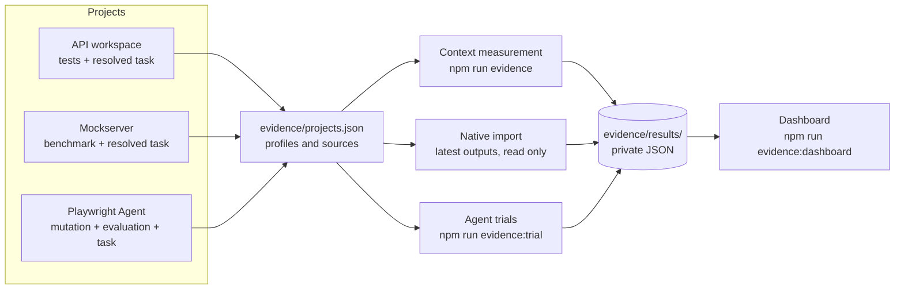

# How the workspace collects evidence

This workspace makes one central claim:

> Giving a coding agent small, exact context (routing, one relevant skill and the
> files a task needs) helps it do correct work at lower cost than giving it a
> whole project.

For Playwright Agent the question is narrower and practical: it is not an
alternative to Claude, Codex or Copilot, it is an add-on to them. Every trial
therefore compares **the same coding agent alone** with **the same agent plus
Playwright Agent's guidance**, and asks what the add-on changes.

This document explains how that claim is measured for each project, how the
measurements are combined into one view, what the current results show, and
where the method is limited. Everything described here runs locally from the
workspace root.

## Three questions, three measurements

| Question | Measurement | Where it comes from |
| --- | --- | --- |
| How much context does an agent need? | **Context**: tokens in the workspace guidance for a task vs the whole project | Measured by the workspace |
| What does the guidance add to a coding agent? | **Agent trials**: the same agent (Claude Opus) on the same task, alone and with the guidance, judged by an independent oracle | Run by the workspace |
| Is each project's own output good? | **Project evidence**: each project's existing test, benchmark and mutation results | Produced by the project, imported as is |

The first two test the workspace itself. The third keeps each project's own
quality visible, so a good context ratio cannot hide a broken project.

## How each project feeds in

Each project is registered once in [`projects.json`](projects.json). The entry
names its context profiles (what an agent loads for a task) and its native
evidence sources (what the project already produces). Projects keep their own
tools and still work standalone; the workspace calls them and never adds
workspace-only scripts to an independent repository.

| Project | Context profile | Native evidence imported |
| --- | --- | --- |
| API workspace (`services/microservices`) | Root and project `AGENTS.md`, the `microservice-change` skill, task `ABC-123` and the files its resolver selects | Surefire report from the RestAssured API tests |
| Role-aware mockserver | Root and project `AGENTS.md`, the `playwright-ui-change` skill, task `UI-ROLE-001` and its resolved files | Interception-vs-mockserver benchmark (`npm run benchmark`) |
| Playwright Agent | Root and project `AGENTS.md`, the router skill plus the assessment or authoring skill, task `CRM-DEMO-001` and the sample CRM tests and page objects | Behavioral mutation campaign and capability evaluation report |

## How the numbers are produced



### Context

For each profile, `npm run evidence` counts the tokens an agent loads for the
task, split into **instructions** (routing plus one skill) and **task files**,
and compares them with every Git-tracked text file in the project. Token counts
use a fixed approximation (the larger of characters ÷ 4 and words × 1.3). They
are for comparing like with like, not for matching a provider's tokenizer.

### Agent trials

`npm run evidence:trial` compares the same agent on the same task, with and
without workspace guidance:

1. **Prepare.** Two clean Git copies of the project's last commit are built
   *outside* the workspace, so the "without" agent cannot wander into workspace
   guidance. The `baseline` copy has all agent guidance removed (`AGENTS.md`,
   `CLAUDE.md`, `.agents/`, `.claude/`, `contexts/` and similar). The `framework`
   copy keeps the project's guidance and adds the workspace context profile,
   bridged so both Codex (`AGENTS.md`, `.agents/skills`) and Claude Code
   (`CLAUDE.md`, `.claude/skills`) see it. Both copies get one identical prompt;
   SHA-256 hashes of the prompt and snapshot are recorded.
2. **Run.** A fresh, headless Claude Code session works in each copy
   (`run-agent`), or a person drives their own agent and records start and
   finish. Each session is limited to a fixed tool allowlist, 60 turns and 45
   minutes. Arm order alternates between repeats.
3. **Judge.** The independent oracle is added to each copy only after the agent
   has finished, so the agent cannot see or edit it. It starts a fresh sample
   app and runs only the task's required tests. A missing test, a wrong
   assertion or a skipped test all count as not completed.
4. **Record.** The collector stores time, turns, model, token usage and the
   result; `npm run evidence:trial:summary` groups paired runs by task and model.

### Project evidence

`npm run evidence` reads the latest output each project already produced and
never reruns it. Each record keeps the source's own evidence kind (for example
`synthetic` or `recorded-mutation-campaign`) and date. A source with no local
output is shown as `not-run`, with the command that produces it.

### Consolidation

All results are written as JSON under ignored `evidence/results/`.
`npm run evidence:dashboard` turns them into one private page: per project, the
context bars, trial results and imported evidence. Nothing is published
automatically.

## Rules the method follows

- Failed, skipped and incomplete runs are kept, never dropped.
- Unknown values are recorded as unknown (null), never as zero.
- The oracle is independent of the agent and added only after the agent finishes.
- Synthetic data is labelled synthetic wherever it appears.
- Dollar figures are Claude Code's estimate of the same usage at API prices.
  They are a comparable measure of effort, not a charge; these runs used a
  Claude subscription.

## Results

<!-- RESULTS:START -->
Measured 13 November 2026 on a MacBook Air, from `evidence/results/`.

### Context

| Project | Instructions | Task files | Selected | Whole project | Ratio |
| --- | ---: | ---: | ---: | ---: | ---: |
| API workspace (`api-test-change`) | 4,940 | 3,268 | 8,208 | 7,591 | **0.92×** |
| Mockserver (`ui-role-change`) | 4,919 | 9,602 | 14,521 | 43,313 | **2.98×** |
| Playwright Agent (`crm-test-authoring`) | 5,089 | 3,650 | 8,739 | 249,034 | **28.5×** |

Workspace guidance is a fixed cost of about 5k tokens per task. It pays off on
larger projects (28× smaller than Playwright Agent) and costs more than reading a
very small project in full (the synthetic API sample).

### Agent trials: Claude Opus alone vs Claude Opus + Playwright Agent

All runs use Claude Code (Opus 5.5) in fresh headless sessions with identical
prompts; the only difference is Playwright Agent's guidance (its `AGENTS.md`
routing and skills). Arm order alternates between repeats. Fairness figures come
from `npm run evidence:audit`, which re-reads every session transcript.

**1. Writing tests** (2 tasks × 3 repeats)

| Task | | Opus alone | Opus + Playwright Agent |
| --- | --- | --- | --- |
| `crm-viewer-export` (UI + API) | Oracle passed | 3/3 | 3/3 |
| | Median time · input tokens · est. cost* | 54 s · 577k · $0.44 | 57 s · 584k · $0.47 |
| | How tests were written | 3/3 reused page object and assertion layers | 3/3 reused page object and assertion layers |
| `crm-manager-export` (API data) | Oracle passed | 3/3 | 3/3 |
| | Median time · input tokens · est. cost* | 52 s · 420k · $0.38 | 69 s · 669k · $0.52 |
| | How tests were written | **3/3 bypassed the test framework**: imported the app's internal `createApi`, ran a private in-process server and **added a file inside the app folder** (~80 lines, new spec) | **2/3 tested through the real app session** by extending the page object and assertions (~40 lines); 1/3 used the existing spec with direct requests; **none changed the app** |

The oracle could not separate the arms; reviewing every diff did. Where neighbouring
code already shows the way (viewer export), Playwright Agent changed nothing. Where
the obvious shortcut is to import the app's internals (manager export), it kept
Opus inside the project's conventions and out of the system under test, for about
40% more input tokens and 17 seconds more per run. Every framework run received the
skill content (6/6).

**2. Coverage assessment** (4 suite variants × 3–6 repeats, 18 pairs)

Four variants of the sample suite plant known gaps: inside a shared assertion
helper, in test bodies, a dropped call, and a test covered in name only. The answer
key is frozen in `trials/assessment/cases.json` and validated by experiment: each
planted gap stays green under a matching app fault, while the original suite catches
the same fault. Both arms get the same weakened suite, criteria and output contract.

| | Opus alone | Opus + Playwright Agent |
| --- | --- | --- |
| Planted (hidden) gaps found | **21/21** | **21/21** |
| Documented gap found (`DASHBOARD-METRIC`) | 18/18 | 18/18 |
| False alarms on covered criteria | 0 | 0 |
| Stayed read-only | 18/18 | 18/18 |
| Median turns · est. cost* | 5 · $0.33 | 6.5 · $0.36 |
| Received the Playwright Agent skill | — | **9/18** |

Claude Opus alone already assessed coverage perfectly, so Playwright Agent added no
measurable accuracy. In half the runs Opus did not open the assessment skill at all,
although the routing pointed to it, and the answers were the same either way (the
nine runs that read it: 7/7 planted gaps, 0 false alarms).

\* Claude Code's estimate of the same usage at API prices; these runs used a
subscription and incurred no API charges.

**What Playwright Agent adds to Claude Opus, so far**

| Activity | Added value | Evidence |
| --- | --- | --- |
| Writing tests | **Yes, for quality and scope**: framework-consistent tests, no edits to the app; no change in pass rate | 6 pairs, diff review |
| Coverage assessment | **None measurable on this benchmark**: Opus alone was already perfect | 18 pairs, frozen key |
| Mutation verification | Being measured: proof by execution that tests catch a defect, with the app left unchanged | Trial in progress |

### Project evidence

| Project | Source | Result |
| --- | --- | --- |
| API workspace | Surefire, 31 Oct 2026 | 5/5 RestAssured tests passed |
| Mockserver | Benchmark, 13 Nov 2026 | 15/15 journeys passed via interception and 15/15 via mockserver; mean journey 92 ms vs 87 ms |
| Playwright Agent | Mutation campaign, 10 Nov 2026 | 2 reviewed faults: 1 killed, 1 survived (a known missing assertion); source restored and unchanged |
| Playwright Agent | Evaluation report, 3 Nov 2026 (**synthetic**) | Acceptance assessment: 9 pass, 2 fail, 5 need review of 16 cases |
<!-- RESULTS:END -->

## What went wrong, and what changed

**The first live trial could not verify its own work.** The tool allowlist blocked
running Playwright tests, so neither agent could check its test before finishing.
Both passed the oracle with near-identical code. The run is excluded from the
results because later runs allowed test execution.

**Our fairness checks had two bugs, found while reviewing the assessment runs.**
The blocked-command detector matched words such as "approval" in normal command
output (this workspace's `AGENTS.md` contains them), so it over-reported blocks; and
the guidance check ignored outputs from commands that printed a skill and then
exited with an error, so it under-reported skill use. Acting on the faulty signals,
six assessment pairs were excluded and rerun, and the first trial was described as
"unable to read its guidance", which was wrong. Both detectors now match only
genuine Claude Code permission denials and actual skill content, `npm run
evidence:audit` recomputes fairness for every run from its transcript, and the six
pairs were restored (their reruns are kept as additional repeats).

Lessons: a passing oracle says the task was completed, not that the comparison was
fair; and fairness checks need the same scrutiny as the results they protect.

## Limits

- **Small samples.** A few tasks with a few repeats each show direction, not
  statistical significance.
- **Synthetic targets.** The sample CRM and the customer-risk service are small
  demonstration apps. Real projects are larger, where context savings should
  matter more.
- **One agent family.** Trials so far use Claude Code; other agents may use
  guidance differently.
- **The oracle checks completion only.** Here it passed every run; the
  meaningful difference was found by reviewing diffs, which is not yet automated.
- **Ceiling effect.** Claude Opus solved the assessment benchmark alone; harder
  suites or a smaller model may show a difference this benchmark cannot.
- **Skill uptake is the agent's choice.** Opus read the assessment skill in only
  half the runs; Playwright Agent's value depends on agents being routed into it.
- **Operational oracle.** Passing the required tests shows completion, not code
  quality; diffs are reviewed by hand.
- **Approximate tokens.** Context sizes are estimates for comparison only.

## Reproduce

```sh
npm run evidence                                            # context + project evidence, all projects
npm run evidence:trial -- prepare --task crm-viewer-export  # then run-agent / collect per arm
npm run evidence:trial:summary
npm run evidence:dashboard                                  # private local page
```

See the [evidence README](README.md) for every command and option, and the
[trial protocol](trials/PROTOCOL.md) for the fairness rules.
