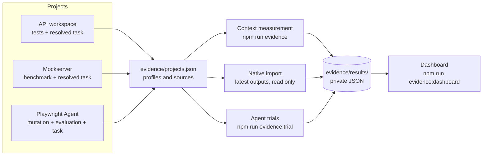

# How the workspace collects evidence

This workspace makes one central claim:

> Giving a coding agent small, exact context (routing, one relevant skill and the
> files a task needs) helps it do correct work at lower cost than giving it a
> whole project.

This document explains how that claim is measured for each project, how the
measurements are combined into one view, what the current results show, and
where the method is limited. Everything described here runs locally from the
workspace root.

## Three questions, three measurements

| Question | Measurement | Where it comes from |
| --- | --- | --- |
| How much context does an agent need? | **Context**: tokens in the workspace guidance for a task vs the whole project | Measured by the workspace |
| Does guidance change what an agent achieves? | **Agent trials**: the same task done with and without workspace guidance, judged by an independent test | Run by the workspace |
| Is each project's own output good? | **Project evidence**: each project's existing test, benchmark and mutation results | Produced by the project, imported as is |

The first two test the workspace itself. The third keeps each project's own
quality visible, so a good context ratio cannot hide a broken project.

## How each project feeds in

Each project is registered once in [`projects.json`](projects.json). The entry
names its context profiles (what an agent loads for a task) and its native
evidence sources (what the project already produces). Projects keep their own
tools and still work standalone; the workspace calls them and never adds
workspace-only scripts to an independent repository.

| Project | Context profile | Native evidence imported |
| --- | --- | --- |
| API workspace (`services/microservices`) | Root and project `AGENTS.md`, the `microservice-change` skill, task `ABC-123` and the files its resolver selects | Surefire report from the RestAssured API tests |
| Role-aware mockserver | Root and project `AGENTS.md`, the `playwright-ui-change` skill, task `UI-ROLE-001` and its resolved files | Interception-vs-mockserver benchmark (`npm run benchmark`) |
| Playwright Agent | Root and project `AGENTS.md`, the router skill plus the assessment or authoring skill, task `CRM-DEMO-001` and the sample CRM tests and page objects | Behavioral mutation campaign and capability evaluation report |

## How the numbers are produced



### Context

For each profile, `npm run evidence` counts the tokens an agent loads for the
task, split into **instructions** (routing plus one skill) and **task files**,
and compares them with every Git-tracked text file in the project. Token counts
use a fixed approximation (the larger of characters ÷ 4 and words × 1.3). They
are for comparing like with like, not for matching a provider's tokenizer.

### Agent trials

`npm run evidence:trial` compares the same agent on the same task, with and
without workspace guidance:

1. **Prepare.** Two clean Git copies of the project's last commit are built
   *outside* the workspace, so the "without" agent cannot wander into workspace
   guidance. The `baseline` copy has all agent guidance removed (`AGENTS.md`,
   `CLAUDE.md`, `.agents/`, `.claude/`, `contexts/` and similar). The `framework`
   copy keeps the project's guidance and adds the workspace context profile,
   bridged so both Codex (`AGENTS.md`, `.agents/skills`) and Claude Code
   (`CLAUDE.md`, `.claude/skills`) see it. Both copies get one identical prompt;
   SHA-256 hashes of the prompt and snapshot are recorded.
2. **Run.** A fresh, headless Claude Code session works in each copy
   (`run-agent`), or a person drives their own agent and records start and
   finish. Each session is limited to a fixed tool allowlist, 60 turns and 45
   minutes. Arm order alternates between repeats.
3. **Judge.** The independent oracle is added to each copy only after the agent
   has finished, so the agent cannot see or edit it. It starts a fresh sample
   app and runs only the task's required tests. A missing test, a wrong
   assertion or a skipped test all count as not completed.
4. **Record.** The collector stores time, turns, model, token usage and the
   result; `npm run evidence:trial:summary` groups paired runs by task and model.

### Project evidence

`npm run evidence` reads the latest output each project already produced and
never reruns it. Each record keeps the source's own evidence kind (for example
`synthetic` or `recorded-mutation-campaign`) and date. A source with no local
output is shown as `not-run`, with the command that produces it.

### Consolidation

All results are written as JSON under ignored `evidence/results/`.
`npm run evidence:dashboard` turns them into one private page: per project, the
context bars, trial results and imported evidence. Nothing is published
automatically.

## Rules the method follows

- Failed, skipped and incomplete runs are kept, never dropped.
- Unknown values are recorded as unknown (null), never as zero.
- The oracle is independent of the agent and added only after the agent finishes.
- Synthetic data is labelled synthetic wherever it appears.
- Dollar figures are Claude Code's estimate of the same usage at API prices.
  They are a comparable measure of effort, not a charge; these runs used a
  Claude subscription.

## Results

<!-- RESULTS:START -->
Measured 13 November 2026 on a MacBook Air, from `evidence/results/`.

### Context

| Project | Instructions | Task files | Selected | Whole project | Ratio |
| --- | ---: | ---: | ---: | ---: | ---: |
| API workspace (`api-test-change`) | 4,940 | 3,268 | 8,208 | 7,591 | **0.92×** |
| Mockserver (`ui-role-change`) | 4,919 | 9,602 | 14,521 | 43,313 | **2.98×** |
| Playwright Agent (`crm-test-authoring`) | 5,089 | 3,650 | 8,739 | 249,034 | **28.5×** |

Workspace guidance is a fixed cost of about 5k tokens per task. It pays off on
larger projects (28× smaller than Playwright Agent) and costs more than reading a
very small project in full (the synthetic API sample).

### Agent trials

Claude Code (Opus 5.5) in fresh headless sessions, three repeats per task with
alternating arm order; medians per run.

| Task | Arm | Oracle passed | Time | Turns | Input tokens | Est. cost* |
| --- | --- | :---: | ---: | ---: | ---: | ---: |
| `crm-viewer-export` (UI + API) | without workspace | 3/3 | 54 s | 16 | 577k | $0.44 |
| | with workspace | 3/3 | 57 s | 16 | 584k | $0.47 |
| `crm-manager-export` (API data) | without workspace | 3/3 | 52 s | 11 | 420k | $0.38 |
| | with workspace | 3/3 | 69 s | 17 | 669k | $0.52 |

\* Claude Code's estimate of the same usage at API prices; runs used a subscription.

**The oracle did not separate the arms: all 12 runs completed.** The difference
showed in how the tests were written, found by reviewing every diff:

| Task | Without workspace | With workspace |
| --- | --- | --- |
| `crm-viewer-export` | 3/3 reused the page object and assertion layers | 3/3 reused the page object and assertion layers |
| `crm-manager-export` | 3/3 bypassed the test framework: imported the app's internal `createApi`, ran a private in-process server and **added a type file inside the app folder**; about 80 lines in a new spec | 2/3 tested through the real app session by extending the page object (`requestAccountsExport`) and assertions (`expectAccountsExportMatchesSeed`), about 40 lines; 1/3 used the existing spec with direct requests; none changed the app |

**Reading.** On a task that neighbouring code already explains (viewer export),
guidance changed nothing. On a task where the obvious shortcut is to import the
app's internals (manager export), guidance kept the agent inside the project's
conventions and out of the system under test, at about 40% more input tokens and
17 seconds more per run. Guidance did not make agents more likely to pass; it
made their tests fit the project.

**Fairness notes.** Every "with workspace" run read its guidance (checked in
transcripts). Blocked commands: 9 across the baseline runs, 1 across the
framework runs, all minor (an env-prefixed app start, a `git stash`, a one-off
Python script, a type-check chain); every agent still ran its own tests except
one framework run. Three repeats per task show direction, not significance.

### Project evidence

| Project | Source | Result |
| --- | --- | --- |
| API workspace | Surefire, 31 Oct 2026 | 5/5 RestAssured tests passed |
| Mockserver | Benchmark, 13 Nov 2026 | 15/15 journeys passed via interception and 15/15 via mockserver; mean journey 92 ms vs 87 ms |
| Playwright Agent | Mutation campaign, 10 Nov 2026 | 2 reviewed faults: 1 killed, 1 survived (a known missing assertion); source restored and unchanged |
| Playwright Agent | Evaluation report, 3 Nov 2026 (**synthetic**) | Acceptance assessment: 9 pass, 2 fail, 5 need review of 16 cases |
<!-- RESULTS:END -->

## What went wrong, and what changed

**The first live trial was invalid.** The tool allowlist blocked chained read
commands such as `cat AGENTS.md SKILL.md; head …`, so the "with workspace" agent
never read its guidance, and neither agent could run its own test. Both passed
the oracle with near-identical code, which looked like a tie but compared
nothing. It was found by reading the session transcripts, not the results.

Changes made: the allowlist now covers read-only inspection, test and type-check
commands (verified with a probe session); `run-agent` reads every transcript and
records and warns about any blocked command; leftover processes are stopped
between arms; and the invalid records were moved to `evidence/results/trials-invalid/`
with a note. The lesson: a passing oracle says the task was completed, not that
the comparison was fair. Check how each run was conducted, not only its result.

## Limits

- **Small samples.** A few tasks with a few repeats each show direction, not
  statistical significance.
- **Synthetic targets.** The sample CRM and the customer-risk service are small
  demonstration apps. Real projects are larger, where context savings should
  matter more.
- **One agent family.** Trials so far use Claude Code; other agents may use
  guidance differently.
- **The oracle checks completion only.** Here it passed every run; the
  meaningful difference was found by reviewing diffs, which is not yet automated.
- **Operational oracle.** Passing the required tests shows completion, not code
  quality; diffs are reviewed by hand.
- **Approximate tokens.** Context sizes are estimates for comparison only.

## Reproduce

```sh
npm run evidence                                            # context + project evidence, all projects
npm run evidence:trial -- prepare --task crm-viewer-export  # then run-agent / collect per arm
npm run evidence:trial:summary
npm run evidence:dashboard                                  # private local page
```

See the [evidence README](README.md) for every command and option, and the
[trial protocol](trials/PROTOCOL.md) for the fairness rules.
