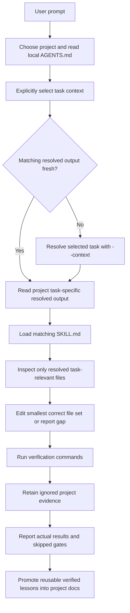

# Agentic Workspace Loop

This repo uses a lightweight loop-engineering pattern for local coding-agent
work. The loop is human-started and verification-focused.

## Required Loop Inputs

- Root `AGENTS.md` for routing and the selected project's local `AGENTS.md`.
- The explicitly selected project task for scope and acceptance criteria. No
  sanitized example is automatically the current request.
- For API/mockserver tasks, the matching ignored
  `contexts/.resolved/<work-item>.yml` for exact paths and commands. Regenerate
  with the appropriate workspace resolver and an explicit `--context` path.
  Use separate outputs for concurrent sessions on the same task.
- The relevant shared skill for API/mockserver work, or Playwright Agent's own
  workflow for that product. Workspace tooling is optional when working from
  a project independently; local instructions identify native checks.
- [loop-budget.md](loop-budget.md) for local machine context and output-token budgets.
- [STATE.md](STATE.md) for available validation examples and owners.
- [Project workflow](../project-workflow.md) for task and evidence ownership.

## Context Rule

Do not turn the selected task YAML into a service catalog. Keep it small and let
the resolver derive exact files from repo conventions, OpenAPI, and source code.
Keep private requirements and raw evidence ignored. Durable project knowledge
belongs in project `docs/`; workspace `knowledge/` holds cross-project lessons.

## Stop Condition

Stop only when the requested change is complete, verification has run or a
blocker is recorded, and the report identifies the selected context, edited files,
evidence locations, actual validation results and skipped gates. The historical
loop log is not a required destination for each task's raw proof.
