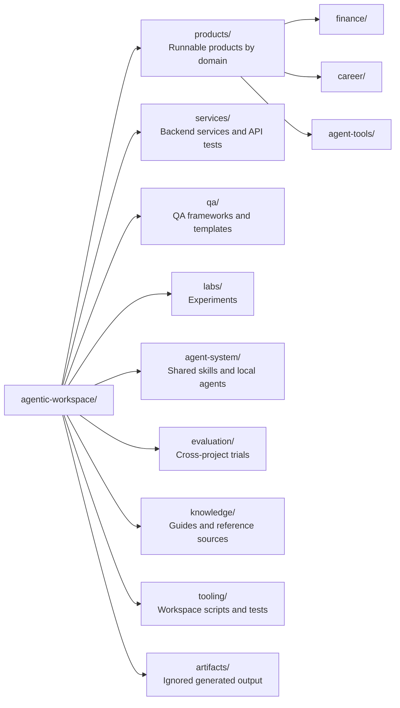
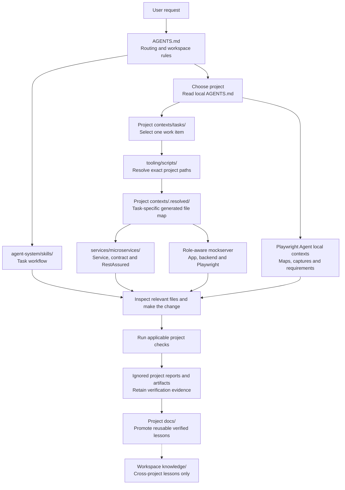

# Agentic workspace folder map

The workspace has nine category folders on disk, organised by intent. Products
are grouped by domain; services, QA frameworks and labs each have their own
root. This map describes the layout after the 10 November 2026 realignment.
[workspace.projects.json](../../workspace.projects.json) is the authoritative
inventory: each project records its group, domain, kind, status and repository.

## High level folder map

Every arrow below represents actual folder containment. These category names are real directories.



## Folder tree and responsibilities

Folders marked `[repo]` are independent nested Git repositories, ignored by the
workspace repository.

```text
agentic-workspace/
├── products/                              — runnable products, grouped by domain
│   ├── finance/
│   │   ├── finfolio-app/          [repo]  — FinFolio portfolio tracker (myFinance)
│   │   └── finfolio-agent/        [repo]  — private alerting and Telegram agent
│   ├── career/
│   │   └── career-agent/          [repo]  — private career scouting agent
│   └── agent-tools/
│       ├── agent-dashboard/               — Agenttrail Kitchen and Map
│       └── framework-benchmark-dashboard/ [repo] — public benchmark platform
├── services/
│   └── microservices/                     — Maven service and API automation
│       ├── AGENTS.md                      — local workflow and verification entrypoint
│       ├── contexts/                      — selected tasks and ignored .resolved/ outputs
│       ├── docs/                          — durable aggregate knowledge
│       ├── xyz-service/                   — Spring Boot source and OpenAPI
│       ├── qa-steps/                      — shared RestAssured helpers
│       ├── qa-projects/
│       │   └── xyz-service-api-tests/     — context-selected API tests
│       └── xyz-deployments/               — Compose and Kubernetes assets
├── qa/
│   ├── playwright-agent/          [repo]  — Playwright Agent and internal quality/ tools
│   ├── playwright-template/       [repo]  — Playwright POM/fixtures starter
│   └── ui-automation/
│       └── role-aware-mockserver/ [repo]  — UI app, mockserver and Playwright tests
├── labs/
│   └── kafka-test-project/        [repo]  — Kafka and event-quality lab
├── agent-system/
│   ├── skills/                            — canonical task workflows
│   ├── local-agents/                      — Pi and llama.cpp setup and launchers
│   └── context-starter/                   — symlink to an external directory
├── evaluation/
│   └── benchmarks/                        — controlled trials and evidence collection
├── knowledge/
│   ├── docs/                              — cross-project guides, research and evidence
│   └── resources/instagram-sources/       — passive upstream reference snapshots
├── tooling/
│   ├── docker/                            — graph-service Dockerfile and Compose
│   ├── scripts/                           — resolvers, graph builders and validation
│   └── tests/                             — checks for shared workspace tooling
└── artifacts/                             — ignored generated and local output
```

This tree expands the category folders and principal project boundaries. Project-local dependencies, Java packages, browser reports and caches remain inside their owning projects.

## Root integration folders

Tools expect these dot-prefixed folders at the root. They sit alongside the nine categories and may be hidden by a file browser.

| Folder | Responsibility |
| --- | --- |
| `.agents/skills/` | Native discovery entrypoints pointing to canonical workflows in `agent-system/skills/`. |
| `.claude/` | Claude bridge; `skills` links to `.agents/skills/`. |
| `.kilo/rules/` | Kilo workspace instruction bridge. |
| `.github/` | Copilot instructions, dependency maintenance and CI workflows. |
| `.githooks/` | Local Git hook scripts; presence does not imply installation. |
| `.vscode/` | Editor tasks and settings. |
| `.idea/` | IDE metadata. |
| `.netlify/` | Local hosting metadata. |
| `.git/` | Root workspace version history. |

Root files include [AGENTS.md](../../AGENTS.md), [package.json](../../package.json), [workspace.projects.json](../../workspace.projects.json), the [VS Code workspace](../../agentic-workspace.code-workspace) and the one-click launchers.

Root instructions, npm/version settings, Git/security rules and launchers remain directly discoverable by their tools. Workflow documents are under [agent-workflow](agent-workflow/LOOP.md), graph-service Docker configuration is under `tooling/docker/`, and the saved [SVG](assets/workspace-diagram.svg) is a historical snapshot; the ownership map above reflects current active projects.

## How context connects to project code



Resolved context identifies files and verification commands; it does not itself
run tests. Select the task explicitly; default root resolver commands use
sanitized examples. UI and API automation remain isolated. The API example
selects `services/microservices/qa-projects/xyz-service-api-tests/`, with no
additional API-test copy under the outer QA category. See the
[project workflow](project-workflow.md) for task, evidence and knowledge ownership.

## Project entrypoints

| Area | Start here |
| --- | --- |
| FinFolio portfolio tracker | [FinFolio app](../../products/finance/finfolio-app/README.md) |
| FinFolio alerts agent | [FinFolio agent](../../products/finance/finfolio-agent/README.md) |
| Career agent | [Career agent](../../products/career/career-agent/README.md) |
| Agent activity observer | [Agent dashboard](../../products/agent-tools/agent-dashboard/README.md) |
| Choose project and task | [Project workflow](project-workflow.md) |
| API services and tests | [Microservices instructions](../../services/microservices/AGENTS.md) |
| Event quality lab | [Kafka project](../../labs/kafka-test-project/README.md) |
| Playwright Agent | [Project instructions](<../../qa/playwright-agent/AGENTS.md>) |
| Role-aware UI automation | [Mockserver instructions](../../qa/ui-automation/role-aware-mockserver/AGENTS.md) |
| Acceptance and mutation evidence | [Playwright Agent quality tools](<../../qa/playwright-agent/quality/README.md>) |
| Controlled trials | [Shared benchmarks](../../evaluation/benchmarks/README.md) |
| Local inference | [Local agents](../../agent-system/local-agents/README.md) |
| Resource adoption | [Catalogue README](instagram/README.md) |
| Existing runtime and QA commands | [Workspace manual](workspace-guide.md) |

Agenttrail observes available activity; Playwright Agent owns test authoring and quality assessment. The standalone QA viewer is retired. Folder existence and dashboard activity do not establish passing tests or completed work.

## What moved on 10 November 2026

| Previous location | Current location |
| --- | --- |
| `projects/agent-dashboard/` | `products/agent-tools/agent-dashboard/` |
| `projects/framework-benchmark-dashboard/` | `products/agent-tools/framework-benchmark-dashboard/` |
| `projects/microservices/` | `services/microservices/` |
| `projects/kafka-test-project/` | `labs/kafka-test-project/` |
| `qa-projects/Playwright Agentic Framework/` | `qa/playwright-agent/` |
| `qa-projects/playwright_pom_fixtures_modular_framework_template/` | `qa/playwright-template/` |
| `qa-projects/ui-automation/` | `qa/ui-automation/` |
| `~/Desktop/myFinance` | `products/finance/finfolio-app/` (symlink left at the old path) |
| `~/Desktop/finfolio-agent` | `products/finance/finfolio-agent/` (symlink left at the old path) |
| Codex career folder `career-agent/` | `products/career/career-agent/` (symlink left at the old path) |

Project IDs did not change. The `projects/` and `qa-projects/` roots are retired
and `workspace:check` fails if they reappear. The private career workbench,
career runtime state and portfolio sites stay outside the workspace.

## What moved on 31 October 2026

| Previous root folder | Current location |
| --- | --- |
| `benchmarks/` | `evaluation/benchmarks/` |
| Retired decision-bench checkout | Ignored recovery artifacts; active quality tools live inside Playwright Agent |
| `contexts/` | Project-owned `contexts/`; reusable service templates in `agent-system/skills/microservice-change/examples/` |
| `skills/` | `agent-system/skills/` |
| `local-agents/` | `agent-system/local-agents/` |
| `context-starter/` | `agent-system/context-starter/` |
| `docs/` | `knowledge/docs/` |
| `resources/` | `knowledge/resources/` |
| `scripts/` | `tooling/scripts/` |
| `tests/` | `tooling/tests/` |
| `graphify-out/` | `artifacts/graphify-out/` |
| `LOOP.md` | `knowledge/docs/agent-workflow/LOOP.md` |
| `STATE.md` | `knowledge/docs/agent-workflow/STATE.md` |
| `loop-budget.md` | `knowledge/docs/agent-workflow/loop-budget.md` |
| `Dockerfile.graphs` | `tooling/docker/Dockerfile.graphs` |
| `docker-compose.graphs.yml` | `tooling/docker/docker-compose.graphs.yml` |
| `Untitled-1.svg` | `knowledge/docs/assets/workspace-diagram.svg` |

Active nested repositories are marked `[repo]` in the tree above and have `repository.nested` set in the registry. Each keeps its Git boundary. The retired decision checkout, with its Git directory and local environment, is recovery data under artifacts. Reference snapshots remain passive and unchanged.

Update this map and the registry when category ownership changes. This is a dated navigation guide, not an automatically generated live inventory.

## Active versus recovery storage

Each product has one working root. The former standalone mockserver path and
legacy decision-bench path are retired. Their preserved originals live under
ignored `artifacts/focused-restructure-20261031/recovery/`; they are not active
projects. Viewer recovery snapshots remain under ignored artifacts. The two task-created
temporary release worktrees were removed with normal Git cleanup after verifying
that their source was committed, no unique/private files remained, and all refs
were preserved. Recovery data has no registry entries or launch aliases.
